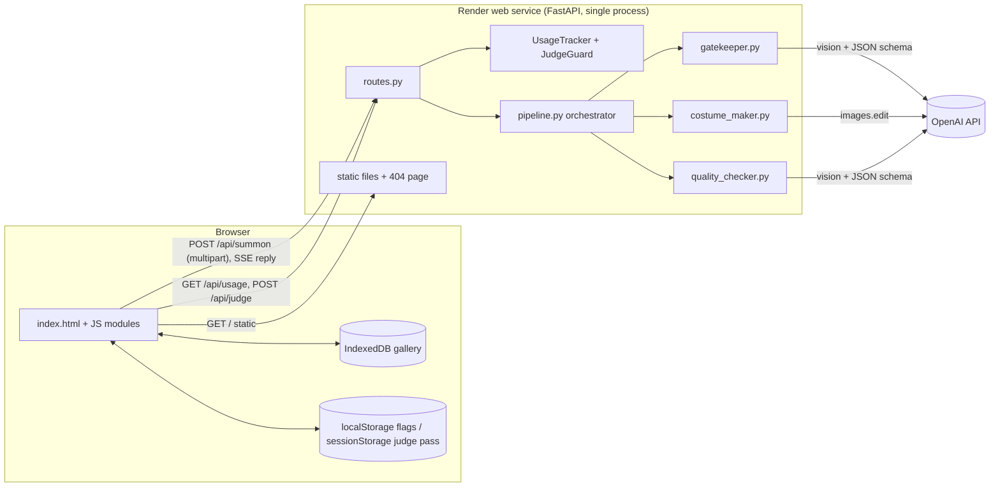
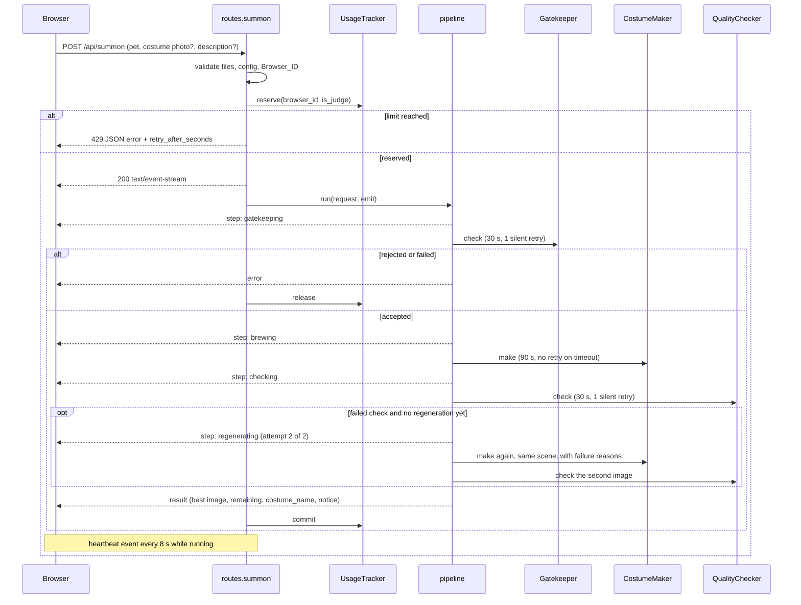

# Design Document: Pawleen Photo Booth

## Overview

Pawleen is one FastAPI service that serves a static frontend (plain HTML, Tailwind CSS, vanilla JavaScript ES modules) and a small JSON/SSE API. A visitor uploads a pet photo and a costume idea. The backend runs three agents in order (Gatekeeper, Costume Maker, Quality Checker) and streams progress back. Images are never stored persistently on the server (they live in memory, apart from Starlette's temporary upload buffers, see Privacy) and are kept for the visitor only in the browser (IndexedDB gallery).

Main design decisions:

| Decision | Choice | Why |
|---|---|---|
| Live progress | One `POST /api/summon` (multipart) whose response is an SSE stream, read in the browser with `fetch` + `ReadableStream` | One request, no job store, no leftover images in memory. If the browser disconnects, the server cancels the work. |
| Tailwind | Tailwind v4 standalone CLI, installed with the Python package `pytailwindcss` (dev only). It builds `static/css/tailwind.css` once, and that file is committed. A hand-written `styles.css` holds fog, glow, animations, and `@font-face`. | No Node.js and no runtime script (Req 14.9). The browser loads only static same-origin CSS, so there is no unstyled flash and no third-party request. Trade-off: after changing classes in HTML or JS, the developer must re-run the build command and commit the output. Render needs no build step because the file is committed. |
| Fonts | Two self-hosted `woff2` files in `static/fonts/` (Creepster for headings, Inter for body text), declared in `styles.css` with `font-display: swap` | No request to a font service (Req 15.5, 16.9). Both fonts are under the SIL Open Font License, and the license files ship with them (Req 15.19). |
| State | In-memory `UsageTracker` guarded by one `asyncio.Lock`, with a reserve / commit / release pattern | Matches the "no database" rule. Failures release the reservation, so they are never counted. |
| Judge pass | Stateless: the browser sends `X-Judge-Pass` (from sessionStorage) with usage and summon requests, and the backend checks it every time | Survives server restarts without a judge session store. Only wrong-attempt counts and usage counts are in memory. |
| Messages | Backend owns the spooky text for API errors (`messages.py`). Frontend owns text for local checks (file type, trimming, gallery). | One place to test the error-to-message mapping. |
| Testing | pytest + pytest-asyncio + Hypothesis. All OpenAI calls are replaced by fake agents. | Zero cost, fast, deterministic. |

### Why POST + streamed response instead of POST + EventSource

`EventSource` can only send `GET` with no body, so photos cannot go through it. Two workable options:

1. POST the files, get a `job_id`, then open `EventSource('/api/jobs/{id}/events')`. Needs a job store, cleanup of images that nobody collects, and extra care for the privacy rule.
2. **Chosen:** POST the files and read the SSE-formatted response body with `fetch`. About 25 lines of JS to parse `event:` / `data:` lines. No server job state. Closing the stream (`AbortController`) cancels the pipeline, which makes the release step and memory cleanup automatic.

The cost of option 2 is no automatic reconnect. This is fine because a pipeline run lasts at most 180 seconds, and Req 7.13 already says a silent stream (30 s without any event) ends in a "connection lost" screen with a back button.

### Render proxy notes

- Send `Content-Type: text/event-stream`, `Cache-Control: no-cache, no-transform`, `X-Accel-Buffering: no`, and `Connection: keep-alive` to stop proxy buffering.
- Do not add `GZipMiddleware` for the stream (compression buffers chunks). Do not add it at all; images are already compressed.
- Heartbeat every 8 seconds (spec requires at most 10) keeps idle-connection timers from firing and feeds the 30 s client watchdog.
- The final `result` event carries the PNG as base64 (about 2 to 4 MB). Yield it as one chunk and then close the stream.
- Run uvicorn without `--workers` (one process). Usage counters are per-process memory, so multiple workers would split the counts.

## Architecture



### Pipeline sequence



The whole run is wrapped in `asyncio.timeout(180)`. The pipeline keeps the "best image so far" in a small state object, so a timeout after the first image exists still returns that image (Req 3.9).

## Folder Structure

```
pawleen-kiroween/
├── .env.example
├── .gitignore                 # includes .env
├── requirements.txt           # pinned versions
├── requirements-dev.txt       # pytest, pytest-asyncio, hypothesis, httpx, pytailwindcss==0.4.2
├── tailwind.config.js         # content paths + theme colors/fonts (purple, orange), loaded with @config
├── tailwind/
│   └── input.css              # @import "tailwindcss"; @config; @source lines
├── README.md                  # setup, run, env variables, deploy to Render, Build note (CSS rebuild), privacy line
├── app/
│   ├── main.py                # create_app(), static mount, 404 handler, health
│   ├── config.py              # Settings, load_settings(), validation
│   ├── routes.py              # /api/summon, /api/usage, /api/judge
│   ├── events.py              # event dataclasses + SSE encode/decode
│   ├── usage.py               # UsageTracker (limits, day reset, lock)
│   ├── judge.py               # JudgeGuard (constant-time compare, lockout)
│   ├── errors.py              # PawleenError, categories, OpenAI error mapping
│   ├── messages.py            # spooky messages + relative time formatting
│   ├── scenes.py              # Spooky_Scene list + selection
│   ├── openai_client.py       # one AsyncOpenAI instance, vision_json(), edit_image()
│   ├── pipeline.py            # orchestrator (the only place that calls agents in order)
│   └── agents/
│       ├── __init__.py
│       ├── gatekeeper.py
│       ├── costume_maker.py
│       └── quality_checker.py
├── static/
│   ├── index.html
│   ├── 404.html
│   ├── css/
│   │   ├── tailwind.css       # GENERATED by the Tailwind CLI, minified, committed
│   │   └── styles.css         # hand-written: @font-face, fog, glow, bats, candle, reduced motion
│   ├── fonts/
│   │   ├── Creepster-Regular.woff2
│   │   ├── Creepster-OFL.txt  # SIL OFL license text for Creepster
│   │   ├── Inter-Variable.woff2   # latin subset
│   │   └── Inter-OFL.txt      # SIL OFL license text for Inter
│   └── js/
│       ├── main.js            # screen switching, state
│       ├── api.js             # summon stream, usage, judge
│       ├── image-prep.js      # EXIF + canvas downscale
│       ├── gallery.js         # IndexedDB wrapper
│       ├── messages.js        # frontend-only spooky text
│       ├── sound.js           # optional WebAudio / audio toggle
│       └── logo.svg.js        # inline SVG strings (or put SVG directly in index.html)
└── tests/
    ├── conftest.py            # fake agents, fake clock, test settings
    ├── test_config.py
    ├── test_usage.py
    ├── test_judge.py
    ├── test_gatekeeper.py
    ├── test_quality_checker.py
    ├── test_costume_maker.py
    ├── test_pipeline.py
    ├── test_routes.py
    ├── test_static_assets.py  # no external URLs, fonts and licenses present, tailwind.css present
    ├── test_errors_messages.py
    ├── test_scenes.py
    └── test_properties.py     # Hypothesis properties (or spread into files above)
```

Render settings: Build command `pip install -r requirements.txt`. Start command (one line, Req 14.7):

```
python -m app.main
```

`app/main.py` reads `PORT` (default 8000; exits with code 1 and a stderr message naming the value if it is not an integer from 1 to 65535) and calls `uvicorn.run(app, host="0.0.0.0", port=port)`. This is simpler than a shell `--port $PORT` command and handles the invalid-PORT rule in Python. Health check path on Render: `/health`.

Pinned `requirements.txt` (versions to be confirmed with `pip index versions` when implementing): `fastapi`, `uvicorn`, `python-multipart` (required for form uploads), `openai`, `pydantic`, `python-dotenv`, `pillow` (only to read image dimensions and verify the returned bytes are an image; optional). `pytailwindcss` goes only in `requirements-dev.txt`, so the Render build never installs or runs it.

### Tailwind build (Req 14.9, 14.10)

**Version choice: Tailwind v4.** Checked on PyPI: `pytailwindcss` 0.4.2 downloads the latest standalone binary, which is v4 by default, and verifies its SHA-256 checksum. Releases before v4 publish no checksums, so a v3 pin would install unverified. v4 differences that matter here:

| Topic | v3 | v4 (chosen) |
|---|---|---|
| Directives in input file | `@tailwind base; @tailwind components; @tailwind utilities;` | `@import "tailwindcss";` |
| Config | `tailwind.config.js` found automatically | CSS-first (`@theme`), no automatic JS config. A JS config is loaded only with `@config "../tailwind.config.js";` |
| Content scanning | `content` array in the config | Automatic source detection plus explicit `@source` lines |
| Browser baseline | older browsers | Safari 16.4+, Chrome 111+, Firefox 128+ |

Because the owner asked for a `tailwind.config.js` with content paths and the purple/orange theme, the input file loads it with `@config` and also lists the same paths with `@source`, so scanning does not depend on how the compatibility layer reads `content`. If a v4 build ever ignores part of the JS config, the fallback is to move the colors into an `@theme` block in `input.css` and delete the JS file. The v4 browser baseline is the main trade-off: a phone older than about 2023 may lose some styles. v3 avoids that but needs an unverified binary pin, so v4 stays.

`tailwind/input.css`:

```css
@import "tailwindcss";
@config "../tailwind.config.js";
@source "../static/**/*.html";
@source "../static/js/**/*.js";
```

`tailwind.config.js` (paths are relative to the config file; colors and fonts feed the utility classes):

```js
module.exports = {
  content: ["./static/**/*.html", "./static/js/**/*.js"],
  theme: {
    extend: {
      colors: { night: "#07040d", witch: { DEFAULT: "#7c3aed", light: "#a78bfa" }, pumpkin: "#f97316" },
      fontFamily: { display: ["Creepster", "serif"], body: ["Inter", "sans-serif"] },
    },
  },
};
```

Build command (run from the repository root; `tailwindcss` is the console script that `pytailwindcss` installs):

```
pip install -r requirements-dev.txt
tailwindcss -i tailwind/input.css -o static/css/tailwind.css --minify
```

To make the result reproducible, set `TAILWINDCSS_VERSION` (for example `v4.x.y`, the exact release confirmed at implementation time) before running `tailwindcss_install` and the build. Without it the newest binary is downloaded on first run. `static/css/tailwind.css` is committed, so the Render build and start commands do not change.

`index.html` links `/static/css/tailwind.css` and then `/static/css/styles.css` with plain `<link rel="stylesheet">` tags. `styles.css` loads after Tailwind, so its rules win on equal specificity.

### Build note (text for README.md)

> **Rebuilding the CSS.** The page styles come from `static/css/tailwind.css`, which is generated and committed, so deploying to Render needs no build. If you change Tailwind classes in `static/**/*.html` or `static/js/**/*.js`, rebuild it:
>
> ```
> pip install -r requirements-dev.txt
> tailwindcss -i tailwind/input.css -o static/css/tailwind.css --minify
> ```
>
> Then commit the updated `static/css/tailwind.css`. Hand-written styles (fog, glow, animations, fonts) live in `static/css/styles.css` and need no build.

## Components and Interfaces

### Configuration (`config.py`)

```python
@dataclass(frozen=True)
class Settings:
    openai_api_key: str
    image_model: str
    vision_model: str
    image_quality: str         # "low" | "medium" | "high", default "medium"
    judge_pass: str            # "" means no judge pass exists
    visitor_daily_limit: int   # default 3
    judge_daily_limit: int     # default 20
    global_daily_cap: int
    # Optional tuning, defaults baked in, not in .env.example's required list:
    gatekeeper_timeout: float = 30
    maker_timeout: float = 90
    checker_timeout: float = 30
    pipeline_timeout: float = 180
    heartbeat_interval: float = 8

def load_settings(env: Mapping[str, str]) -> tuple[Settings, list[str]]: ...
```

`load_settings` returns the settings plus a list of problem **names** (never values). If the list is not empty, `app.state.pipeline_enabled = False`; `/api/summon` returns `config_error` and everything else keeps working (Req 13.6, 13.10, 13.11). Variables:

| Variable | Rule |
|---|---|
| `OPENAI_API_KEY` | required, non-empty |
| `OPENAI_IMAGE_MODEL` | required, non-empty (example in `.env.example`: `gpt-image-1`) |
| `OPENAI_VISION_MODEL` | required, non-empty (example: `gpt-4o-mini`) |
| `OPENAI_IMAGE_QUALITY` | optional; allowed `low`, `medium`, `high`; default `medium`. An invalid value logs one warning that names the variable (never the value) and uses `medium`. It is **not** added to the problem list, so the pipeline stays enabled (Req 13.12 to 13.14). |
| `JUDGE_PASS` | optional; empty means judge mode off |
| `VISITOR_DAILY_LIMIT` | optional, default 3, int 1..1,000,000 |
| `JUDGE_DAILY_LIMIT` | optional, default 20, int 1..1,000,000 |
| `GLOBAL_DAILY_CAP` | required, int 1..100,000 (the stricter rule from Req 10.2 applies) |
| `PORT` | optional, default 8000 |

`.env` is loaded with `python-dotenv` at startup. Model names are never hardcoded; the examples above live only in `.env.example` and are examples, not recommendations. The quality warning is emitted by `load_settings` itself through `logging` (for example `"OPENAI_IMAGE_QUALITY is invalid, using medium"`).

### API endpoints

| Method and path | Purpose | Success | Errors |
|---|---|---|---|
| `GET /` | `index.html` | 200 | |
| `GET /static/...` | assets | 200 | 404 spooky page |
| `GET /health` | health check | `200 {"status":"ok"}` (no OpenAI call, no lock) | |
| `GET /api/usage` | remaining spells | `200 {"remaining":2,"limit":3,"is_judge":false,"reset_in_seconds":4000}` | |
| `POST /api/judge` | validate pass, body `{"pass":"..."}` | `200 {"valid":true,"remaining":20}` or `{"valid":false}` | `429 judge_locked` with `retry_after_seconds` |
| `POST /api/summon` | multipart: `pet_photo` (file), `costume_photo` (file, optional), `description` (text, optional); optional header `X-Judge-Pass` | `200` SSE stream | JSON error (see below), sent before streaming starts |

All routes set the `browser_id` cookie when missing (`HttpOnly`, `SameSite=Lax`, `Secure` when served over HTTPS, 1 year, value `secrets.token_urlsafe(16)`). The cookie is set through a small dependency `get_browser_id(request, response)`.

**Browser_ID fallback (Req 10.5):** if the cookie is missing, the identifier is `"anon:" + sha256(client_ip + user_agent)[:16]`, where `client_ip` is the first entry of `X-Forwarded-For` (Render sits behind a proxy). Global cap still applies regardless.

**Pre-stream errors** are normal JSON responses `{"error": {"code": "...", "message": "...", "retry_after_seconds": 1234|null}}`. Checks, in this order: config enabled, file validation (type, size, non-empty, description trimmed to at most 200 chars), `usage.reserve()`. Only then does the stream start.

### SSE event schema (`events.py`)

Each event is `event: <name>\ndata: <json>\n\n`.

| Event | Data | When |
|---|---|---|
| `step` | `{"step":"gatekeeping"\|"brewing"\|"checking","attempt":1,"max_attempts":2,"recast":false}` | A pipeline step begins (within 500 ms). A regeneration sends `brewing` and `checking` again with `attempt:2, recast:true`. |
| `heartbeat` | `{"t": <unix seconds>}` | Every 8 s while running |
| `result` | `{"image_b64":"...","mime":"image/png","costume_name":"Witch costume"\|null,"remaining":2,"limit":3,"notice":null\|"wonky"\|"not_verified","message":null\|"..."}` | Terminal success |
| `error` | `{"code":"...","message":"...","show_chips":true\|false,"retry_after_seconds":null}` | Terminal failure |

Exactly one terminal event (`result` or `error`) ends the stream. The `notice` field carries the spooky message for the wonky and not-verified cases (Req 6.7, 6.10, 6.11, 3.9). `remaining` is computed after the commit, so it already reflects the just-finished generation (Req 8.11).

### Usage tracking (`usage.py`)

```python
class UsageTracker:
    def __init__(self, settings, clock=utc_now): ...
    async def reserve(self, browser_id: str, is_judge: bool) -> Reservation  # raises LimitReached
    async def commit(self, r: Reservation) -> None
    async def release(self, r: Reservation) -> None
    async def remaining(self, browser_id: str, is_judge: bool) -> int
    def seconds_until_reset(self) -> int      # (0, 86400]
```

Internal state, all under one `asyncio.Lock`:

```python
day: date                           # current UTC day
visitor: dict[str, int]             # committed counts per browser
judge: dict[str, int]
global_count: int                   # non-judge committed
pending_visitor: dict[str, int]     # reservations in flight
pending_judge: dict[str, int]
pending_global: int
```

- `reserve` first rolls the day if `clock().date() != day` (clears all dicts; in-flight reservations carry the old day and are dropped on commit/release if the day changed). It then checks `committed + pending < limit` for the browser (`visitor_daily_limit` or `judge_daily_limit`) and, for non-judges, `global_count + pending_global < global_daily_cap`. If both pass, it increments the pending counters and returns a `Reservation(browser_id, is_judge, day)`.
- `commit` moves pending to committed. `release` removes the pending slot and changes nothing else.
- Because check-and-increment happens inside one lock, concurrent requests from one browser can never exceed the allowance (Req 10.16). Reserving at the start (not at the end) is what makes the concurrency guarantee possible; releasing on any failure is what makes failures free.
- Judge generations touch only `judge[browser_id]`, never `global_count` or other browsers (Req 11.8).
- Restart means empty dicts (Req 10.15).

Who commits and releases: `routes.summon` owns the reservation. The stream generator uses `try/finally`: on a `result` it commits, otherwise (error, timeout, client disconnect, cancellation) it releases. This keeps the pipeline free of accounting.

### Judge guard (`judge.py`)

```python
class JudgeGuard:
    def __init__(self, settings, clock): ...
    def is_valid(self, presented: str) -> bool        # hmac.compare_digest, pure
    async def verify(self, browser_id, presented) -> JudgeResult   # applies lockout
```

- `is_valid`: returns `False` when the configured pass is empty or the presented value is empty or longer than 128 chars. Otherwise `hmac.compare_digest(presented.encode(), configured.encode())` (Req 11.2, 11.13).
- Lockout: per browser, a list of wrong-attempt timestamps (in memory). Five wrong attempts set `locked_until = now + 1 hour`. While locked, `verify` returns `locked` with `retry_after_seconds` without comparing, even for the correct pass. A correct pass clears nothing but is not counted as wrong. Expired lockout resets the wrong-attempt count.
- The `X-Judge-Pass` header on `/api/usage` and `/api/summon` uses `is_valid` only (no lockout counting), so a stale pass in a tab cannot lock anyone out.
- The pass value is never logged or returned.
- The `?pass=` flow: frontend reads the URL parameter on load, calls `POST /api/judge`, on success stores the pass in `sessionStorage` and calls `history.replaceState` to remove the parameter.

### Agents

All three agents are plain classes with one async method and a constructor that takes the OpenAI helper, so tests substitute fakes.

```python
# agents/gatekeeper.py
class GatekeeperVerdict(BaseModel):          # also the JSON schema sent to OpenAI
    has_animal: bool
    description_ok: bool                     # true when there is no description
    costume_photo_ok: bool                   # true when there is no costume photo
    costume_name: str | None                 # only asked for when a photo is given and no description
    reason: Literal["ok","no_animal","bad_costume"]

class Gatekeeper:
    async def check(self, req: CostumeRequest) -> GatekeeperDecision   # accept/reject + costume_name

# agents/costume_maker.py
class CostumeMaker:
    async def make(self, req: CostumeRequest, scene: str, failure_reasons: list[str] | None) -> bytes  # PNG bytes

# agents/quality_checker.py
class CheckResult(BaseModel):
    same_pet: bool
    costume_applied: bool
    no_cropping: bool
    reasons: list[str]                       # one per failed check
    @property
    def passed_count(self) -> int: ...
    @property
    def all_passed(self) -> bool: ...

class QualityChecker:
    async def check(self, pet: bytes, costumed: bytes, costume_text: str) -> CheckResult
```

Agents do not retry and do not know about timeouts; they raise on failure. The orchestrator applies `asyncio.timeout` and the retry policy. This keeps each agent module tiny and the timing rules in one file.

**Gatekeeper** sends the pet photo (and costume photo if present) as `input_image` data URLs plus the description. The system prompt encodes Req 4: accept any animal (several animals, humans with an animal are fine), reject only when no animal, unintelligible or harmful description, or harmful/unrelated costume photo. It returns `costume_name` (max 40 chars) only when there is a costume photo and no description; code enforces this again (`normalize_costume_name`: strip, cut to 40, `None` when a description exists or the text is empty).

**Costume Maker** builds the prompt with `build_prompt(costume_text, scene, failure_reasons)`. Every prompt contains: keep species, fur/feather colors, markings, and facial features; portrait orientation (height greater than width); full pet and full costume centered with at least 5% margin so hats, ears, and paws are not cropped; place the pet in `scene`; dress only the animals (not people). If a costume photo exists it is passed as a second input image and the prompt says to use it as costume reference. On a regeneration, the failure reasons are appended as "Fix these problems: ...".

**Quality Checker** sends the original pet and the costumed image and asks for the three booleans with rules from Req 6.3 to 6.5 (cropping fails only when head, ears, hat, paws, or main costume is cut by the edge; a tail tip or cape edge touching the border passes).

### Scenes (`scenes.py`)

```python
KEYWORD_SCENES = {"wizard": "a magical library with floating candles",
                  "vampire": "a dark castle under a red moon",
                  "pumpkin": "a foggy pumpkin patch at night",
                  "pirate": "a ghost ship on a stormy sea",
                  "ghost": "a misty graveyard with fireflies"}
GENERIC_SCENES = [ ... at least 6 other spooky scenes ... ]

def choose_scene(costume_text: str, previous: str | None, rng) -> str
```

If a keyword appears in the lowercased costume text (description, or the Gatekeeper's Costume_Name for photo-only requests), the mapped scene is returned. Otherwise a random scene from `GENERIC_SCENES` that is not equal to `previous` (the list always has at least 2 entries, so one exists). The last scene per Browser_ID lives in a small in-memory dict (`last_scene[browser_id]`, updated after the choice). The orchestrator calls `choose_scene` once and reuses the result for the regeneration (Req 5.8).

### Pipeline orchestrator (`pipeline.py`)

```python
async def run_pipeline(req: CostumeRequest, agents: Agents, settings: Settings,
                       emit: Callable[[Event], Awaitable[None]],
                       scene: str) -> PipelineOutcome
```

`PipelineOutcome` is either `Success(image, costume_name, notice)` or `Failure(error_code)`. Helper:

```python
async def with_silent_retry(call, timeout):    # used by gatekeeper and checker
    for attempt in (1, 2):
        try:
            async with asyncio.timeout(timeout):
                return await call()
        except (TimeoutError, OpenAIErrorRetriable):
            if attempt == 2: raise
```

Flow:

1. Emit `step gatekeeping`. `decision = with_silent_retry(gatekeeper.check, 30)`. Reject becomes `Failure(no_animal | bad_costume)`; exhausted retries become `Failure(gatekeeper_failed)`. Credit errors and safety refusals are not retried and map to their own codes.
2. Emit `step brewing`. `image1 = maker.make(...)` inside `asyncio.timeout(90)` with **no retry**. Timeout becomes `Failure(maker_timeout)`.
3. Emit `step checking`. `r1 = with_silent_retry(checker.check, 30)`. If the checker fails twice, return `Success(image1, notice="not_verified")`.
4. If `r1.all_passed`, return `Success(image1)`.
5. Otherwise emit `step brewing` with `attempt=2, recast=true`, call the maker again with `r1.reasons` and the same scene. A failure here returns `Success(image1, notice="wonky")` (the visitor already has an image, which beats showing an error; the image is not verified better than r1, and it is counted because an image is returned).
6. Emit `step checking` (attempt 2), `r2 = with_silent_retry(checker.check, 30)`. Checker failure returns `Success(image2, notice="not_verified")`.
7. If `r2.all_passed`, return `Success(image2)`. Otherwise `best = image2 if r2.passed_count >= r1.passed_count else image1`; return `Success(best, notice="wonky")`.

`run_pipeline` writes `state.best_image` as soon as an image exists. The caller wraps the call in `asyncio.timeout(180)`. On timeout, if `state.best_image` is set the route emits `result` with `notice="not_verified"` and counts it; otherwise it emits `error pipeline_timeout` and releases.

Heartbeats come from the route, not the pipeline: the pipeline writes events into an `asyncio.Queue`, and the stream generator does `await asyncio.wait_for(queue.get(), heartbeat_interval)`, emitting a `heartbeat` on each timeout. This guarantees a heartbeat even while an OpenAI call blocks.

### OpenAI usage (`openai_client.py`)

One shared `AsyncOpenAI(api_key=..., max_retries=0)`. `max_retries=0` matters: the SDK retries 2 times by default, which would break the "no retry for the maker" cost rule and double-bill. Our timeouts are enforced with `asyncio.timeout` and also passed as `timeout=` per call so the HTTP connection is closed.

**Check against the OpenAI docs at implementation time.** Model names, supported image sizes, and `quality` options change over time. The model names in `.env.example`, the `size` value, and the allowed quality values below are examples from the time of writing. Before coding, confirm them in the current OpenAI documentation for the chosen image model, and adjust `size`, the allowed `OPENAI_IMAGE_QUALITY` values, and the example names if they differ.

Image edit (checked against the current OpenAI Python reference for `images.edit`, which accepts one or more source images for GPT Image models):

```python
resp = await client.images.edit(
    model=settings.image_model,
    image=[("pet.png", pet_bytes, "image/png"), ("costume.png", costume_bytes, "image/png")],  # costume optional
    prompt=prompt,
    size="1024x1536",            # portrait; confirm supported sizes in the docs
    quality=settings.image_quality,   # "low" | "medium" | "high" (Req 13.13)
    timeout=90,
)
png = base64.b64decode(resp.data[0].b64_json)
```

Vision with structured output (Responses API, Pydantic model as `text_format`):

```python
resp = await client.responses.parse(
    model=settings.vision_model,
    input=[{"role": "user", "content": [
        {"type": "input_text", "text": prompt},
        {"type": "input_image", "image_url": f"data:image/jpeg;base64,{b64}"},
    ]}],
    text_format=GatekeeperVerdict,
    timeout=30,
)
verdict = resp.output_parsed        # None means the model refused or output was invalid
```

If `output_parsed` is `None`, treat it as a safety refusal (`refused`) when the response contains a refusal item, otherwise as a retriable bad output. SDK details change between releases, so pin the `openai` version and confirm these two call shapes against the pinned version before coding. A thin wrapper (`vision_json`, `edit_image`) is the only code that touches the SDK, so a signature change is a one-file fix.

### Error taxonomy (`errors.py`, `messages.py`)

```python
class PawleenError(Exception): code: str
def classify_openai_error(exc: Exception) -> str
```

| Code | Trigger | HTTP (pre-stream) | Message (summary) | Counted? |
|---|---|---|---|---|
| `bad_upload` | missing/unsupported/empty/too large file | 400 | names the failed check | no |
| `visitor_limit` | Visitor_Daily_Limit reached | 429 | "The spirits need rest! ... return in 3 hours." | no |
| `global_cap` | Global_Daily_Cap reached | 429 | "The photo booth is closed for the night..." | no |
| `config_error` | missing/invalid env | 503 | "The photo booth isn't open yet..." | no |
| `no_animal` | Gatekeeper reject | stream error | "The spirits say that's not a pet!" | no |
| `bad_costume` | Gatekeeper reject | stream error | "couldn't brew that one" + chips | no |
| `gatekeeper_failed` | Gatekeeper failed twice | stream error | "The Gatekeeper dozed off..." | no |
| `credits_depleted` | `RateLimitError` with `insufficient_quota` | stream error | "Our cauldron is out of magic..." (one log line, no secrets) | no |
| `temporary_failure` | 5xx, `APIConnectionError`, `APITimeoutError` | stream error | "A storm is disturbing the spirits..." | no |
| `refused` | `BadRequestError` with `moderation_blocked` or a refusal | stream error | "The spirits refused this spell." + chips | no |
| `maker_failed` / `maker_timeout` | maker error or timeout | stream error | "costume could not be made, try again" | no |
| `pipeline_timeout` | 180 s, no image | stream error | "The cauldron went cold..." | no |
| `judge_locked` | 5 wrong passes | 429 | "The crypt is sealed... try again in 1 hour" | n/a |

`classify_openai_error` maps SDK exceptions (`openai.RateLimitError`, `openai.APIStatusError`, `openai.APIConnectionError`, `openai.APITimeoutError`, `openai.BadRequestError`) to codes using only the exception type, status code, and `error.code`. Raw OpenAI text, tracebacks, and the API key never reach a response (Req 12.7). Unknown exceptions become `temporary_failure` and are logged with `logger.exception` (the log handler formatter never receives image data; see Privacy).

`messages.format_relative(seconds) -> str`: when `seconds >= 3600`, `ceil(seconds/3600)` hours ("1 hour", "3 hours"); otherwise `max(1, ceil(seconds/60))` minutes. The limit messages use it; reset times are never shown in UTC.

### Static hosting and spooky 404 (`main.py`)

```python
app.mount("/static", StaticFiles(directory="static"), name="static")

@app.get("/")           # FileResponse(static/index.html)
@app.get("/health")     # {"status": "ok"}

@app.exception_handler(StarletteHTTPException)
async def not_found(request, exc):
    if exc.status_code == 404 and not request.url.path.startswith("/api"):
        return FileResponse("static/404.html", status_code=404)
    return JSONResponse({"error": {"code": "not_found"}}, status_code=exc.status_code)
```

Unknown paths return the 404 page with status 404 (never `index.html`). `404.html` shows "🪦 This page has been buried..." and a button linking to `/`.

## Frontend Design

### Screens and state

`main.js` holds a small `state` object and shows one `<section>` at a time by toggling the `hidden` class: `booth` (input form), `progress`, `result`, `gallery`, `error`. A top bar with the logo, a nav button (Booth / Gallery), and the Sound toggle appears on every screen (reachable in one interaction, Req 15.10, 15.17). A footer with the privacy line (Req 16.7) is on every screen. The Privacy Banner shows until dismissed (`localStorage.pawleenBannerDismissed`).

State kept across screens: `petPrepared` (Blob), `petPreviewUrl`, `costumePrepared`, `description`. Failure and "back" return to the booth without touching these (Req 3.3, 7.14, 12.6). "Try another costume" clears only the costume fields. "New pet" clears everything.

The "Summon Costume" button is enabled when `petPrepared && (costumePrepared || description.trim().length > 0)` and disabled while a request is running.

### Image preparation (`image-prep.js`)

```js
export async function prepareImage(file) -> { blob, width, height, small }   // throws PrepError('type'|'unreadable')
```

Steps:
1. Check `file.type` in JPEG/PNG/WebP and `file.size > 0`.
2. `createImageBitmap(file, { imageOrientation: 'from-image' })`. Modern browsers apply EXIF rotation here, so no EXIF parser is needed. If it throws, report `unreadable`.
3. If the longest side is over 2048 or the file is over 10 MB, draw the bitmap to a canvas scaled to at most 2048 px and export with `canvas.toBlob(cb, 'image/jpeg', 0.9)`. If the result is still at least 10 MB, retry with quality 0.8, then 0.7, then fail as `unreadable`. Otherwise still redraw through the canvas when the file has EXIF orientation, so the uploaded bytes are upright too (simplest rule: always re-encode through the canvas; cost is small).
4. Return `small = Math.min(w, h) < 512` to show the "Small photo" note.

The "Developing your photo in the darkroom" message shows while this runs. A failed file leaves the earlier selection and preview unchanged.

### Gallery (`gallery.js`)

IndexedDB database `pawleen`, object store `spells` (`keyPath: 'id'`, autoIncrement) with fields `{ id, blob, costumeName, savedAt }` and an index on `savedAt`.

```js
saveSpell({blob, costumeName})   // costumeName = description || gatekeeperName || "Mystery costume"
listSpells()                     // newest first
deleteSpell(id)
clearAll()
```

Name rule: `description.trim()` if non-empty, else `costume_name?.trim()` if non-empty, else `"Mystery costume"`. Storing a Blob (decoded from the base64) avoids the 33% base64 overhead. Save errors (quota, unavailable) show the "not saved" message and keep the image downloadable for the session. A failed read at load shows the "gallery could not be loaded" message and never deletes anything. Delete and clear use the shared "Banish / Keep it" confirm dialog.

### Reading the stream (`api.js`)

```js
export async function summon(formData, judgePass, onEvent, signal) {
  const res = await fetch('/api/summon', { method: 'POST', body: formData, signal,
                          headers: judgePass ? { 'X-Judge-Pass': judgePass } : {} });
  if (!res.ok) { onEvent({ type: 'error', ...(await res.json()).error }); return; }
  const reader = res.body.pipeThrough(new TextDecoderStream()).getReader();
  let buf = '';
  for (;;) {
    const { value, done } = await reader.read();
    if (done) break;
    buf += value;
    let i;
    while ((i = buf.indexOf('\n\n')) >= 0) {
      const frame = buf.slice(0, i); buf = buf.slice(i + 2);
      onEvent(parseFrame(frame));        // {type, data}
    }
  }
}
```

A watchdog timer (reset on every event, including heartbeat) fires after 30 s and aborts the stream with the "connection lost" screen (Req 7.13). Credentials are same-origin, so cookies are sent automatically.

### Progress screen

Three step rows (pending dimmed, active glowing, complete with ✅), a glowing progress bar (width 0%, 33%, 66%, 100%), the message for the current step, and during brewing a line rotator on a 4 s `setInterval` ("Stirring the cauldron...", "Adding a pinch of moonlight...", "Almost there, the spell is thickening..."). A `recast:true` step shows "The spell is being recast..." with "Attempt 2 of 2". On `result` the screen shows "🎃 Your spooky pet is ready!" and switches to the result view within 1 second.

### Result view, sharing, download

The costumed image is shown with `object-fit: contain` inside a portrait container, so no pixel is cropped. The Before/After view shows the original pet preview next to it. A fog-clearing reveal is a CSS animation (an overlay with a blurred gradient fading out) that is skipped when `prefers-reduced-motion: reduce`. Download uses an `<a download>` with an object URL. Share uses `navigator.canShare({files:[file]})` then `navigator.share`, and falls back to download when unavailable or on error. The remaining text uses `"🕯️ N spells left tonight"` with singular for 1.

### Visual design

- `tailwind.config.js` extends colors (`night` near black, `witch` purple, `pumpkin` orange) and the `display` and `body` font families; the compiled result is `static/css/tailwind.css`.
- Fonts are self-hosted (Req 15.5): Creepster (headings, SIL OFL) and Inter (body, SIL OFL), both `woff2` files in `static/fonts/`. `styles.css` declares them:

  ```css
  @font-face { font-family: "Creepster"; src: url("/static/fonts/Creepster-Regular.woff2") format("woff2");
               font-weight: 400; font-style: normal; font-display: swap; }
  @font-face { font-family: "Inter"; src: url("/static/fonts/Inter-Variable.woff2") format("woff2");
               font-weight: 100 900; font-style: normal; font-display: swap; }
  ```

  The font stacks end in generic fallbacks (`"Creepster", serif` and `"Inter", sans-serif`), so text stays readable if a file fails to load within 3 seconds. Creepster has a single weight, so headings use `font-weight: 400` to avoid faux bold. The license files `Creepster-OFL.txt` and `Inter-OFL.txt` sit next to the fonts (Req 15.19).
- The browser makes no third-party requests: CSS, fonts, scripts, and images are all same-origin, and the only calls from the page go to the app's own `/api/...` paths (Req 16.9). `test_static_assets.py` checks this (see Testing Strategy).
- Background: body is `#07040d` (luminance well under 0.05). Fog is two large radial-gradient layers in a fixed, `pointer-events: none` element that drifts with a CSS keyframe. Bats and ghosts are tiny inline SVG elements that float with CSS animation. A candle glow is a pulsing radial gradient. No external images.
- Pet upload area styled as a glowing portal (rounded oval, conic-gradient swirl border). Costume area styled as a bubbling cauldron (dark pot shape with CSS bubbles).
- Primary buttons use `box-shadow` glow in default, hover, and `:focus-visible` states.
- `@media (prefers-reduced-motion: reduce)` turns off fog drift, bats, candle flicker, and the reveal (`animation: none`), and shows the result immediately. The progress bar width change stays (conveys state).
- Controls under 768 px have `min-height: 44px; min-width: 44px`.
- Logo: a ghost with a paw print as an inline `<svg>` in the header. The same SVG, URL-encoded, is the favicon (`<link rel="icon" href="data:image/svg+xml,...">`). Decorative SVGs get `aria-hidden="true"`. Meaningful images get `alt` text.
- Sound: `sound.js` holds `enabled` (default `false`, saved in `localStorage.pawleenSound`). Effects are played only when enabled, using short generated tones from the WebAudio API (no audio files to ship). The toggle is a button in the top bar with `aria-pressed`.
- Keyboard: all controls are real `<button>`/`<input>` elements, tab order follows reading order, dialogs trap focus and return it on close.

## Data Models

Backend (Pydantic / dataclasses):

```python
@dataclass
class CostumeRequest:
    pet: bytes; pet_mime: str
    costume: bytes | None; costume_mime: str | None
    description: str                    # trimmed, max 200 chars, "" if none
    @property
    def costume_text(self) -> str       # description, else gatekeeper costume_name

@dataclass
class Reservation: browser_id: str; is_judge: bool; day: date

@dataclass
class PipelineState: best_image: bytes | None = None; costume_name: str | None = None
```

Event payloads are Pydantic models in `events.py` with `to_sse() -> str` and `parse_sse(str) -> Event` (the parser exists for tests and mirrors the JS parser).

Browser: gallery record `{id, blob, costumeName, savedAt}` in IndexedDB; `localStorage` keys `pawleenBannerDismissed` and `pawleenSound`; `sessionStorage` key `pawleenJudgePass`.

## Correctness Properties

*A property is a characteristic or behavior that should hold true across all valid executions of a system-essentially, a formal statement about what the system should do. Properties serve as the bridge between human-readable specifications and machine-verifiable correctness guarantees.*

Reflection notes: the counting criteria are merged into Properties 1 and 2; retry rules merge into Property 5; judge isolation is folded into Property 3. UI, visual, accessibility, and hosting criteria are not properties and are covered by example tests or a manual checklist (see Testing Strategy).

### Property 1: Limits are never exceeded

For any sequence of reserve, commit, and release operations (including operations run concurrently with `asyncio.gather`) across any set of browsers and any limit settings, the committed count plus pending reservations for each browser never exceeds its applicable limit, and the non-judge global committed plus pending count never exceeds the Global_Daily_Cap.

**Validates: Requirements 10.1, 10.2, 10.6, 10.7, 10.16**

### Property 2: Only returned images are counted

For any pipeline outcome (accepted, rejected, timeout, OpenAI error, safety refusal, credits depleted, client disconnect, or success with any number of silent retries or a regeneration), the visitor, judge, and global counts increase by exactly 1 in total if and only if a Costumed_Image was returned, and are unchanged otherwise.

**Validates: Requirements 3.8, 3.9, 4.12, 4.14, 6.13, 10.17, 12.5**

### Property 3: Judge and visitor counts are isolated

For any interleaving of judge and non-judge generations across browsers, a judge generation changes only that browser's judge count, and a non-judge generation changes only that browser's visitor count and the global count.

**Validates: Requirements 11.7, 11.8**

### Property 4: Reset and remaining are consistent

For any clock time and counts, `seconds_until_reset` is an integer in 1..86400, `remaining` is an integer from 0 to the applicable limit, and after the UTC date changes every count reads as 0.

**Validates: Requirements 10.12, 10.13**

### Property 5: Relative time rounds up to whole units

For any positive number of seconds, `format_relative` returns whole hours rounded up when at least 3600 seconds remain, otherwise whole minutes rounded up (minimum 1), and the result never contains a UTC timestamp.

**Validates: Requirements 10.8, 10.9, 10.10**

### Property 6: Upload validation accepts exactly the allowed files

For any content type and byte size, the upload validator accepts the file if and only if the type is JPEG, PNG, or WebP and the size is greater than 0 and at most 10,485,760 bytes.

**Validates: Requirements 3.2, 3.3, 3.5**

### Property 7: Silent retries are bounded and the maker is never retried on timeout

For any sequence of attempt outcomes (success, error, timeout) for each agent, the Gatekeeper is called at most 2 times, the Quality Checker is called at most 2 times per image, and a Costume Maker timeout never triggers another maker call.

**Validates: Requirements 4.13, 4.14, 5.10, 6.6, 6.7**

### Property 8: At most one regeneration

For any pair of checker results, the Costume Maker is called at most 2 times per request, and a regeneration is triggered only when the first image has at least one failed check and the checker produced a result for it.

**Validates: Requirements 6.8, 6.12**

### Property 9: Best-of-two selection

For any two check results for two images where the retry image fails at least one check, the returned image is the one with more passed checks, and the retry image when the counts are equal.

**Validates: Requirements 6.10, 6.11**

### Property 10: Rejection skips downstream agents

For any Gatekeeper rejection, the Costume Maker and Quality Checker are never called and the final event is an error.

**Validates: Requirements 4.9, 4.12**

### Property 11: Spooky scene selection

For any costume text and any previous scene, the chosen scene is the mapped scene when the text contains wizard, vampire, pumpkin, pirate, or ghost (case-insensitive); otherwise it is a scene from the predefined list that differs from the previous scene. A regeneration uses the same scene as the first attempt.

**Validates: Requirements 5.6, 5.7, 5.8**

### Property 12: Prompts contain the required instructions

For any costume text, scene, and list of failure reasons, the built image prompt contains the preserve-appearance, portrait-orientation, full-pet-with-5%-margin, and scene instructions, and contains every failure reason when reasons are given.

**Validates: Requirements 5.2, 5.3, 5.4, 5.5, 6.8**

### Property 13: Costume name rules

For any Gatekeeper-returned name and description, the normalized Costume_Name is at most 40 characters, is `None` whenever a description was given, and is `None` for empty or whitespace-only names.

**Validates: Requirements 4.15, 4.16**

### Property 14: Judge pass comparison

For any presented string and configured pass, the pass is valid if and only if the configured pass is non-empty and the strings are equal. An empty configured pass makes every presented value invalid.

**Validates: Requirements 11.2, 11.13**

### Property 15: Judge lockout

For any sequence of timed pass attempts for one browser, once 5 invalid attempts have occurred, every attempt in the following hour is refused (even a correct one), and refused attempts never reveal validity.

**Validates: Requirements 11.10**

### Property 16: Configuration validation reports names, never values

For any environment mapping, `load_settings` lists exactly the variables that are missing (for required ones) or out of range, and the list and any log text built from it contain none of the variable values. `OPENAI_IMAGE_QUALITY` is never in the list: the resulting `image_quality` equals the value when it is `low`, `medium`, or `high`, and `medium` otherwise (a missing variable included), and an invalid value produces a warning that names the variable but not the value.

**Validates: Requirements 13.4, 13.5, 13.6, 13.10, 13.11, 13.12, 13.14**

### Property 17: Error mapping is safe and total

For any exception raised by the OpenAI helper (including messages containing the API key, stack text, or image data), `classify_openai_error` returns one defined error code, and the resulting response message contains none of the exception text.

**Validates: Requirements 12.1, 12.2, 12.4, 12.7**

### Property 18: SSE event round trip

For any valid event (`step`, `heartbeat`, `result`, `error`), `parse_sse(event.to_sse())` returns an equal event.

**Validates: Requirements 7.1, 7.2, 12.7**

## Error Handling

- **Pre-stream failures** (bad upload, limits, config) return JSON with a spooky `message`. The browser shows the message and stays on the booth with all selections kept.
- **In-stream failures** send one `error` event, then close. The generator's `finally` releases the reservation.
- **Client disconnect** cancels the generator (`asyncio.CancelledError`), which releases the reservation and drops the image bytes. The orchestrator is run as a task and cancelled in `finally`.
- **Silent retries** produce no events and no visible messages.
- **Frontend watchdog**: 30 s without any event ends in "connection lost" with a back button.
- **Credits depleted** logs exactly one line: timestamp and category `credits_depleted`. No headers, no keys, no exception text.
- **Unexpected exceptions** become `temporary_failure` to the visitor and are logged by type only (not `str(exc)`, which can echo request details).
- **Local file errors** (type, unreadable, trimmed description, storage full) are frontend-only and use `messages.js`.

## Privacy

- **No persistent storage.** The application code never writes images to a database or to a file it creates. Uploaded bytes live in local variables of the request handler. Starlette may use temporary upload buffers on its own: `UploadFile` is a `SpooledTemporaryFile` that stays in memory up to about 1 MB and spills to a temporary file above that. The design accepts this (Req 16.3) and requires that the buffers are deleted immediately after reading: the route does `data = await file.read()` and then `await file.close()` in a `finally` block, for both `pet_photo` and `costume_photo`, including on validation errors and cancellation. Closing a `SpooledTemporaryFile` removes its temp file.
- After the response, the request object and `PipelineState` go out of scope; the stream generator sets references to `None` in `finally` so memory is released within seconds.
- Log hygiene: log formatters never include request bodies, and `CostumeRequest.__repr__` is overridden to print only sizes. A test asserts that no log record produced during a run contains base64 or image bytes.
- Images go only to OpenAI. The privacy banner and footer text follow Req 16.5 and 16.7 and must not say that no disk is ever touched; they say that photos are not stored.
- The browser contacts only the app's own origin: no CDN, font service, analytics, or external image (Req 16.9).

## Testing Strategy

PBT applies to the logic layer (usage counting, judge guard, scene selection, retry and selection rules, config validation, error mapping, SSE encoding, relative time). It does not apply to CSS, animations, layout, accessibility, or the real OpenAI service. Those use example tests, a manual checklist, and (optionally) one live smoke test run by hand.

### Tooling

- `pytest`, `pytest-asyncio` (async tests), `hypothesis` (properties), `httpx` with FastAPI `TestClient` or `ASGITransport` (route tests). Keep dev dependencies in `requirements-dev.txt`.
- Run: `pytest -q`. No network, no API key, no cost.

### Test doubles (`tests/conftest.py`)

- `FakeGatekeeper`, `FakeCostumeMaker`, `FakeQualityChecker`: constructed with a **script** (list of outcomes: a value, an exception, or `"hang"` to sleep longer than the timeout). They record `calls`.
- `FakeClock`: a mutable `now` for day rollover and lockout tests.
- `test_settings()`: small timeouts (for example 0.05 s) so timeout tests finish quickly.
- Route tests build the app with `create_app(settings, agents=fakes)`, so the real OpenAI client is never created. An autouse fixture sets `OPENAI_API_KEY` to a fake value and fails the test if `openai.AsyncOpenAI` is instantiated unexpectedly.
- A tiny fake PNG/JPEG byte string helper (a few bytes with the right content type) is enough, because agents are faked.

### Property tests (Hypothesis, at least 100 examples each)

Each test carries a tag comment, for example:
`# Feature: pawleen-photo-booth, Property 1: Limits are never exceeded`
and runs with `@settings(max_examples=100)` (or more). One property test per property above. Planned strategies:

| Property | Generator |
|---|---|
| 1, 3 | list of ops `(browser, is_judge, action)`; stateful variant with `RuleBasedStateMachine`; plus an `asyncio.gather` example with limit 3 and 10 requests |
| 2 | random scripts for the three fake agents (accept/reject/error/timeout, check results) run through `run_pipeline` + route accounting |
| 4, 5 | datetimes in a wide range, integers 1..10^7 |
| 6 | `sampled_from` of types plus random text types, sizes around 0 and 10 MiB |
| 7, 8, 9, 10 | outcome scripts, triples of booleans for two checker results |
| 11, 12, 13 | `text()` including the keywords, previous scene from the list or `None` |
| 14, 15 | `text()` and timed attempt lists with `FakeClock` |
| 16 | `dictionaries` of env names to random strings |
| 17 | exception instances (`RateLimitError`, `APIStatusError`, `APIConnectionError`, `APITimeoutError`, generic) built with random message text containing a fake key |
| 18 | builds of event models from `text()`, ints, and base64 strings |

### Example-based unit and route tests

- **Limits**: 3 successes then the 4th returns 429 `visitor_limit` with `retry_after_seconds`; global cap blocks the next non-judge visitor but not a judge; counts reset after `FakeClock` crosses UTC midnight; a missing cookie still counts toward the global cap.
- **Judge pass**: correct pass raises the limit to 20; wrong pass keeps 3; empty configured pass rejects everything; 5 wrong attempts lock for 1 hour and the 6th attempt (even correct) returns `judge_locked`; two browsers have separate judge counts; the pass value is absent from every response body and captured log.
- **Gatekeeper rejection paths**: no animal returns `no_animal` and no maker call; bad description returns `bad_costume` with chips flag; harmful costume photo returns `bad_costume`; photo-only request returns a name of at most 40 chars; description request returns no name; two consecutive failures return `gatekeeper_failed`; a first failure then success proceeds silently (no extra events); every rejection leaves counts unchanged.
- **Quality Checker**: all pass returns image 1 with no regeneration; one failed check triggers exactly one regeneration with the reasons in the prompt; second failure returns the better image and the `wonky` notice; checker fails twice on image 1 returns image 1 as `not_verified` with no regeneration; checker timeout then success is silent; checker fails twice on image 2 returns image 2 as `not_verified`.
- **Timeouts** (tiny settings): gatekeeper `hang` is retried once, then `gatekeeper_failed`; maker `hang` yields `maker_timeout` after exactly one maker call; checker `hang` follows the retry rule; a total timeout with no image returns `pipeline_timeout` and counts 0; a total timeout after image 1 exists returns that image with `not_verified` and counts 1.
- **Events**: a `step` event precedes each agent call; a `heartbeat` appears while a fake agent sleeps longer than the interval; the stream always ends with exactly one terminal event; the stream response has the no-buffering headers.
- **Disconnect**: cancelling the stream releases the reservation (count unchanged, reserve again succeeds).
- **Hosting**: `/health` returns 200 quickly; unknown path returns 404 with the "buried" page and never `index.html`; `/api/nope` returns JSON 404; invalid `PORT` exits non-zero with the value named on stderr; `config_error` response when env is incomplete while `/health` and static files still work.
- **Config** (`test_config.py`): `OPENAI_IMAGE_QUALITY` unset gives `medium`; `low`, `medium`, `high` are accepted as given; an invalid value (for example `ultra` or an empty string) gives `medium`, logs a warning that contains the variable name but not the value, and leaves the pipeline enabled (the problem list stays empty when everything else is valid).
- **Static assets** (`test_static_assets.py`): `index.html`, `404.html`, and `styles.css` contain no `http://` or `https://` URL to another origin and no reference to a Tailwind CDN or Google Fonts; `static/css/tailwind.css`, both `woff2` files, and both `*-OFL.txt` files exist; every `url(...)` in `styles.css` is a same-origin path; `styles.css` declares both fonts with `font-display: swap`.
- **Privacy**: the spy `UploadFile` used in a route test reports `closed` after the request for both photos, on success, on validation failure, and on pipeline error (Req 16.3); after a full run, a temp-directory listing is unchanged (no files left behind, including for an upload above 1 MB that forces Starlette to spool); `caplog` contains no base64 or raw bytes at DEBUG level; the credits-depleted path logs exactly one entry without the key.
- **OpenAI wrapper (mocked SDK)**: `edit_image` is called with the env model name, portrait size, `quality` equal to `settings.image_quality`, and both images when a costume photo exists (`test_costume_maker.py` checks that each of `low`, `medium`, `high` reaches the fake unchanged on every maker call, including the regeneration); `vision_json` passes `text_format` and the env model; client is created with `max_retries=0`.

### Frontend and manual checks

No JS build, so JS stays small and gets a manual checklist (and optional browser smoke test later): EXIF-rotated phone photo shows upright; 12 MP photo is downscaled below 10 MB; wrong file type keeps the old preview; button enable rules; trimming of pasted text beyond 200; progress states and the 4 s line rotation; 30 s watchdog (stop the server mid-run); result view shows the whole portrait image; download and share fallback; gallery save, reload order, banish/keep, clear all; storage failure messages; reduced-motion setting; keyboard-only run; widths 320 to 1920 with no horizontal scroll; contrast spot checks; sound off by default.

Pure JS helpers that carry rules (costume name fallback, relative-free message formatting, SSE frame parsing) are written as small exported functions so they can later be tested with `node --test` if desired. This is optional and out of the Python test run.

### Environment file

`.env.example` (placeholders only):

```
OPENAI_API_KEY=your-openai-api-key
# Model names below are EXAMPLES only. Check the current OpenAI docs; names change.
OPENAI_IMAGE_MODEL=gpt-image-1
OPENAI_VISION_MODEL=gpt-4o-mini
# Image quality: low, medium, or high. Optional, default medium. Higher costs more.
OPENAI_IMAGE_QUALITY=medium
JUDGE_PASS=change-me-or-leave-empty
VISITOR_DAILY_LIMIT=3
JUDGE_DAILY_LIMIT=20
GLOBAL_DAILY_CAP=200
```

On Render, set the same names in the service's Environment tab. `.env` is listed in `.gitignore`.

## Design Notes and Open Points

- **Judge pass on every request** means the pass is sent in a header on each call. It travels only over HTTPS on Render and is never logged.
- **Single process**: counters are in memory, so deploy one instance. Scaling out needs a shared store, which is outside the stated scope.
- **SDK names** (`responses.parse`, `images.edit` parameters) should be confirmed against the pinned `openai` version at implementation time.
- **OpenAI model names, image sizes, and quality options** change. Check the current OpenAI documentation at implementation time and update the `.env.example` examples, the `size` value, and the allowed `OPENAI_IMAGE_QUALITY` values if they differ. If the chosen model rejects `quality`, the call fails as `maker_failed`, so verify with one live smoke test before the demo.
- **Tailwind v4 browser baseline** (Safari 16.4+, Chrome 111+, Firefox 128+): very old phones may lose some styles. Pin the Tailwind binary with `TAILWINDCSS_VERSION` for reproducible builds.
- **Font files**: the `woff2` files and OFL texts must be downloaded from the fonts' official sources and committed; confirm each license text matches the downloaded version.
